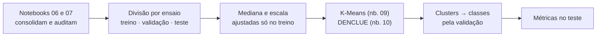

<div align="center">

# 🤖 Análise com K-Means e DENCLUE

**Como os dados do laboratório foram preparados, modelados e avaliados nos notebooks**

[← Voltar ao README](README.md) •
[Metodologia](METODOLOGIA.md) •
[Validação](VALIDACAO.md)

</div>

---

## 📋 Índice

1. [Dados e cenários](#-dados-e-cenários)
2. [Preparação](#-preparação)
3. [K-Means](#-k-means)
4. [DENCLUE didático](#-denclue-didático)
5. [Resultados no teste variável](#-resultados-no-teste-variável)
6. [Cenário simples](#-cenário-simples)
7. [Limitações](#-limitações)

> [!NOTE]
> Os notebooks usam NumPy, pandas, matplotlib, scikit-learn e Jupyter. As métricas vêm das **saídas salvas**. Os modelos não foram treinados de novo durante a conferência documental.

---

## 📚 Dados e cenários

Os notebooks analisam o tráfego do laboratório Modbus TCP local. Há dois cenários:

| Cenário | Dados | Avaliação |
|---|---|---|
| **Simples** | Um ensaio, 140 janelas: 119 legítimas e 21 de carga | Ajuste, atribuição de classe e avaliação no **mesmo** ensaio |
| **Variável** | 12 ensaios, 2.160 janelas, manutenção e carga em degraus | Separação **por ensaio** em treino, validação e teste |

<details>
<summary><b>Parâmetros de cada cenário</b></summary>

<br>

| | Simples | Variável |
|---|---|---|
| Cliente legítimo | Cerca de 1 consulta/s | Jitter de 30% |
| Manutenção | Não citada | Intervalo base de 0,2 s |
| Carga | Alvo de 50 consultas/s por 20 s | Alvos de 2, 5 e 10 consultas/s |
| Duração por ensaio | 140 s | 180 s: 60 s normais, 60 s de carga, 60 s de recuperação |

Em ambos, a carga **se soma** às consultas legítimas.

</details>

O nome "realista" em algumas saídas antigas designa o cenário variável. Os dois cenários são locais e didáticos.

---

## 🧹 Preparação



Os notebooks 06 e 07 consolidam e auditam os dados. A chave é o par `ensaio, janela`, e cada ensaio pertence a **um único** conjunto.

| Conjunto | Seeds | Janelas | Legítimas | Carga |
|---|---|---:|---:|---:|
| Treino | 101–106 | 1.080 | 714 | 366 |
| Validação | 107–109 | 540 | 357 | 183 |
| Teste | 110–112 | 540 | 357 | 183 |

### Entradas do modelo

O laboratório exporta seis características, na ordem documentada no [README](README.md). A seleção posterior dos modelos é:

```python
COLUNAS_ML = [
    "taxa_requisicoes",
    "latencia_ms",
    "latencia_disponivel",
]
```

**Por que só essas três?**

- Os bytes são redundantes com a taxa neste protocolo de mensagens fixas.
- As frações de erro e timeout não variam no lote.
- `consultas_cliente` fica de fora porque identifica a origem legítima.
- `latencia_disponivel` depende da instrumentação do cliente. Isso limita a transferência direta do modelo para captura passiva de tráfego.

### Dados faltantes e escala

- O lote variável tem **155 janelas** sem latência.
- A mediana do treino, **2,4758 ms**, preenche esses valores.
- `StandardScaler` é ajustado no treino para taxa e latência. O indicador de disponibilidade continua binário.
- Validação e teste recebem as mesmas transformações.
- O notebook 08 compara `StandardScaler` e `RobustScaler`.

### Papel dos rótulos

Rótulos e metadados ficam no consolidado para avaliação, mas **não** entram em `COLUNAS_ML`.

> [!IMPORTANT]
> Nos notebooks 09 e 10, a maioria dos rótulos da validação define a classe de cada cluster. O ajuste é **não supervisionado**, mas essa atribuição de classes **usa supervisão**.

---

## 🎯 K-Means

| Parâmetro | Valor |
|---|---|
| `k` | 5 |
| `random_state` | 42 |
| `n_init` | 20 |
| Notebook | 09 |

A escolha de `k=5` é exploratória, apoiada no cotovelo e na interpretação dos grupos. Com `StandardScaler`, a maior Silhouette entre os valores comparados ocorre em `k=7` (0,4836). Com `k=5` ela é 0,4101. Portanto, **cinco grupos não maximizam essa métrica**.

Como funciona a previsão:

1. Os centróides são ajustados no treino.
2. As demais observações vão para o centróide mais próximo.
3. O mapa cluster → classe da validação é aplicado ao teste.

---

## 🌌 DENCLUE didático

O notebook 10 estima uma densidade Gaussiana, desloca cada observação até um atrator e une atratores próximos.

| Parâmetro | Valor |
|---|---|
| Tolerância do deslocamento | `1e-4` |
| Máximo de iterações | 100 |
| Distância de fusão | 0,05, no espaço preparado |
| `sigma` | 0,42 |
| `xi` | 0,018497080747067 |

**Configuração principal:**

- O limiar `xi` é o ponto médio entre as duas menores densidades dos atratores representativos do treino.
- O modelo mantém **dois clusters** e classifica **quatro** observações do treino como ruído.
- A Silhouette dos pontos mantidos é **0,505234**.

**Escolha do `sigma`:** a busca cobriu de 0,15 a 1,00, com refinamento entre 0,38 e 0,55. A seleção considera a estrutura dos grupos e a convergência, além da Silhouette.

**Previsão:**

- O treino serve de referência de densidade.
- O atrator é associado ao representante sobrevivente mais próximo.
- Não convergência ou densidade abaixo de `xi` resultam em **ruído**.
- A classe do ruído também é atribuída pela validação.

> [!NOTE]
> A implementação é *inspirada* em DENCLUE, com regras próprias de fusão e previsão. Não equivale por inteiro à implementação de referência.

---

## 📈 Resultados no teste variável

Fonte: notebook 09, células 35–38, e notebook 10, células 46–49 (índices a partir de zero). O teste tem **540 janelas**, das quais **183** são de carga.

### Métricas

| Métrica | K-Means | DENCLUE didático |
|---|---:|---:|
| Acurácia | **0,7796** | 0,7722 |
| Precisão | 0,7254 | **1,0000** |
| Recall | **0,5628** | 0,3279 |
| F1 | **0,6338** | 0,4938 |
| Taxa de falsos positivos | 0,1092 | **0,0000** |

### Matriz de confusão

| Contagem | K-Means | DENCLUE didático |
|---|---:|---:|
| Verdadeiros negativos | 318 | 357 |
| Falsos positivos | 39 | 0 |
| Falsos negativos | 80 | 123 |
| Verdadeiros positivos | 103 | 60 |

### Detecção por nível de carga

| Nível de carga | Janelas no teste | Detecções K-Means | Detecções DENCLUE |
|---|---:|---:|---:|
| Baixa | 60 | 3 (5,00%) | 0 (0,00%) |
| Média | 60 | 42 (70,00%) | 0 (0,00%) |
| Alta | 63 | 58 (92,06%) | 60 (95,24%) |

### Leitura dos resultados

- **K-Means** detectou mais janelas de carga, mas gerou falsos alarmes.
- **DENCLUE** não teve falsos positivos neste teste, mas deixou de detectar 123 das 183 janelas de carga.
- Os dois acertam bem a carga **alta**. A diferença está nas cargas baixa e média: o DENCLUE não detectou nenhuma janela dessas.
- Precisão de 100% neste conjunto **não** garante ausência de falsos alarmes em novos ensaios.

---

## 🔍 Cenário simples

Nos notebooks 11 e 12, K-Means e DENCLUE chegam ao mesmo resultado:

| Verdadeiros negativos | Falsos positivos | Falsos negativos | Verdadeiros positivos |
|---:|---:|---:|---:|
| 119 | 0 | 1 | 20 |

| Acurácia | Precisão | Recall | F1 |
|---:|---:|---:|---:|
| 0,9929 | 1,0000 | 0,9524 | 0,9756 |

| Modelo | Configuração |
|---|---|
| K-Means | `k=3` |
| DENCLUE | `sigma=0.50`, `xi=0.029538869390677` |

> [!WARNING]
> Estes números são **exploratórios**: o mesmo ensaio participa do ajuste e da avaliação. Eles não são comparáveis aos do cenário variável, que usa ensaios separados.

---

## 🚧 Limitações

| Tema | Limitação |
|---|---|
| **Realismo** | O lote usa loopback, sensores sintéticos e um único processo. Não representa uma planta industrial |
| **Rótulos** | Indicam sobreposição com a carga, inclusive em janelas de fronteira. Não certificam indisponibilidade nem intenção maliciosa |
| **Estatística** | São três ensaios de teste, e as janelas de um ensaio não são observações independentes. Não há intervalos de confiança por ensaio |
| **DENCLUE** | O treino não exclui pontos sem convergência, enquanto a previsão os trata como ruído |
| **Transição** | `janela_transicao` marca mudanças entre condições vizinhas, incluindo as extremidades. Não mede a sobreposição temporal exata |
| **Notebook 12** | A tabela comparativa final tem valores digitados. As fontes dos resultados são as matrizes e métricas dos notebooks 09–12 |
| **Fora do escopo** | Não foram avaliados ataques que alteram conteúdo sem aumentar a taxa, generalização para redes físicas nem custo de detecção em operação contínua |
