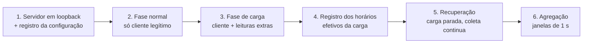

# 🧪 Método experimental

**Como o laboratório do ClusterGuard SCADA foi construído, executado e avaliado**

[← Voltar ao README](README.md) •
[Algoritmos](ALGORITMOS_IA.MD) •
[Validação](VALIDACAO.md)

---

## 📋 Índice

1. [Visão geral](#-visão-geral)
2. [Implementação realizada](#-implementação-realizada)
3. [Organização e responsabilidades](#-organização-e-responsabilidades)
4. [Protocolo de execução](#-protocolo-de-execução)
5. [Aquisição e características](#-aquisição-e-características)
6. [Avaliação sem vazamento de rótulos](#-avaliação-sem-vazamento-de-rótulos)
7. [Limitações do experimento](#-limitações-do-experimento)

---

## 🎯 Visão geral

| Item | Resumo |
|---|---|
| **Ambiente** | Laboratório local em Python 3.11+, biblioteca padrão, tudo em um processo e em loopback |
| **Papéis** | RTU virtual Modbus TCP, estação supervisória (cliente legítimo) e gerador de carga |
| **Protocolo** | Leitura de holding registers (FC03), unit id 1 |
| **Saída** | Logs brutos e janelas de 1 s, com características e rótulos em arquivos separados |
| **Pergunta** | Detectores não supervisionados identificam janelas com carga anormal? |

---

## 🔧 Implementação realizada

### Papéis e sensores

O laboratório tem três papéis lógicos. A RTU mantém dois sensores sintéticos, atualizados a cada segundo:

| Sensor | Valor nominal | Variação |
|---|---:|---|
| Temperatura | 60 | inteira uniforme de ±3 |
| Pressão | 100 | inteira uniforme de ±10 |

A seed é configurável e registrada. Ela reproduz a sequência dos sensores, mas **não** os tempos de escalonamento do sistema operacional.

### Mensagens Modbus

O laboratório usa mensagens binárias Modbus TCP de leitura de holding registers (FC03, endereço inicial 0, quantidade 2 e unit id 1). O servidor também aceita outras faixas válidas dentro dos seus 100 registradores e devolve respostas de exceção para funções ou endereços não suportados.

É uma implementação didática do subconjunto de leitura, feita com a biblioteca padrão. Os arquivos originais baseados em pymodbus foram preservados separadamente em `originais/`.

### Cliente legítimo

**Perfil padrão (`fixo`).**
- O cliente consulta os sensores em intervalos programados de um segundo.
- Quando uma consulta atrasa, não compensa com uma rajada.
- Exceções de conexão, respostas inválidas e timeouts são registradas, e as consultas seguintes continuam.
- O bloco de comunicação tem timeout de 0,5 s. O fechamento da conexão ocorre fora dele.
- Cada consulta abre uma conexão TCP nova, ao contrário da conexão persistente do cliente original.

**Perfil `variavel`.**
- O intervalo base recebe um fator uniforme entre `1-jitter` e `1+jitter`, com piso de 0,1 s.
- A manutenção usa outro intervalo base e também recebe jitter, inclusive com perfil fixo.
- A condição de manutenção é avaliada após cada tentativa, com início inclusivo e fim exclusivo.
- `atividades_legitimas.csv` registra os horários **planejados**. Ele não confirma o instante da primeira consulta de manutenção.
- O gerador do cliente usa `seed + 10_000`, separado do gerador dos sensores. Repetir a seed não fixa os tempos de execução.

### Carga

A carga pode ser **fixa** ou dividida em **três segmentos** de mesma duração planejada, com taxas baixa, média e alta. Os limites de 200 consultas/s e 120 s valem para a taxa máxima e para a duração total da carga. `ataques.csv` registra os horários **medidos** de cada segmento, depois do término.

---

## 🧩 Organização e responsabilidades

| Elemento | Responsabilidade |
|---|---|
| `RTU` | Mantém os sensores e atende TCP local |
| `request` | Realiza uma leitura |
| `polling` | Agenda tentativas legítimas ou de carga |
| `run` | Coordena fases e encerramento |
| `aggregate` | Transforma logs em janelas |
| `main` | Interpreta e valida a CLI, antes do início do ensaio |
| `Configuracao` | Explicita os parâmetros |
| `Janela` | Reúne os acumuladores |

A comunicação dos clientes com o servidor passa por sockets, mesmo que todos compartilhem o mesmo processo e event loop.

**Por que um único processo?** Reduz a preparação do ambiente e permite encerrar todos os papéis em uma execução. `laboratorio.py` também permanece em um arquivo porque essas responsabilidades ainda cabem em uma leitura sequencial.

**Qual o custo?** CPU, disco e escalonamento são compartilhados. Uma lentidão no processo pode afetar ao mesmo tempo quem gera, atende e mede. Por isso os resultados não isolam gargalos de uma rede industrial.

> [!NOTE]
> O contrato completo dos CSVs e do JSON está no [README](README.md#-dados-produzidos).

---

## 🔄 Protocolo de execução

1. Iniciar servidor exclusivo em loopback e registrar a configuração.
2. Coletar a fase normal com apenas o cliente legítimo.
3. Manter o cliente legítimo e executar leituras adicionais por duração limitada.
4. Registrar separadamente os horários efetivos de início e fim da carga.
5. Interromper a carga e manter a coleta durante a recuperação.
6. Finalizar os registros e agregar em janelas temporais de um segundo.

### Configurações usadas

| | Execução padrão | Lote final |
|---|---|---|
| **Ensaios** | 1 | 12 (seeds 101–112), 180 s cada |
| **Fases** | 60 s normal, 20 s carga, 60 s recuperação | 60 s por fase |
| **Carga** | Teto de 50 consultas/s | Segmentos de 20 s a 2, 5 e 10 consultas/s |
| **Cliente** | Intervalo fixo de 1 s | Jitter de 30% |
| **Manutenção** | Opcional | Entre 20 e 35 s, com intervalo de 1 s para 0,2 s |

Recomenda-se repetir a mesma configuração em **pelo menos três execuções independentes** e registrar as taxas efetivamente atingidas.

---

## 📡 Aquisição e características

### O que cada papel registra

| Papel | Registro |
|---|---|
| **Servidor** | Captura o horário após ler o cabeçalho Modbus e grava o registro após enviar a resposta. Registra bytes Modbus de aplicação nas duas direções |
| **Cliente legítimo** | Latência fim a fim, sucesso, timeout e valores de processo |
| **Gerador de carga** | Suas próprias tentativas, em arquivo separado |

### Características por janela de 1 s

| Característica | Definição |
|---|---|
| Taxa de requisições | Requisições atendidas por segundo |
| Bytes recebidos | Bytes de aplicação recebidos pelo servidor |
| Bytes enviados | Bytes de aplicação enviados pelo servidor |
| Latência | Média das latências do cliente legítimo |
| Taxa de timeout | Proporção de timeouts |
| Taxa de erro | Proporção total de falhas, incluindo timeouts |

As consultas são atribuídas às janelas pelo **instante de início da tentativa** no cliente e pelo **instante de recepção** no servidor. Nas fronteiras, os dois instantes podem cair em janelas diferentes.

### Cuidados de interpretação

- Os bytes **não** representam captura de pacotes nem uso total de rede.
- Todas as leituras têm tamanho fixo, então taxa e bytes são correlacionados. Isso motiva a seleção de entradas descrita em [`ALGORITMOS_IA.MD`](ALGORITMOS_IA.MD).
- Os valores dos sensores são contexto e **não** são alterados pela carga.

---

## 🔒 Avaliação sem vazamento de rótulos

| Arquivo | Contém |
|---|---|
| `features.csv` | Características. **Sem** rótulos, fase, seed ou horários da carga |
| `avaliacao.csv` | Identificador da janela, fase e rótulo (sobreposição com o intervalo de carga) |

**Como os dados são usados:**

- O laboratório exporta as seis características documentadas, na ordem contratada.
- Os notebooks selecionam depois três entradas: taxa, latência e indicador de disponibilidade.
- Mediana e escalas do cenário variável são ajustadas **somente no treino**.
- Os rótulos não entram nas entradas numéricas.
- Na validação, os rótulos mapeiam clusters para classes. Depois, no teste, servem para calcular as métricas.

> [!IMPORTANT]
> O ajuste dos clusters não usa rótulos, mas **a atribuição de classes usa supervisão**. Ao relatar resultados, diga isso.

**Leitura correta do rótulo:**

- Detectar aumento de taxa pode acontecer sem falha de disponibilidade. O rótulo mostra a **presença da carga experimental** e não comprova DoS.
- Clusters minoritários não correspondem necessariamente a esse rótulo.
- Os exemplos curtos de validação não substituem os ensaios finais do grupo.

---

## 🚧 Limitações do experimento

| Tema | Limitação |
|---|---|
| **Status do ensaio** | `run` grava `status: completo` antes de agregar. Uma interrupção pode deixar a pasta sem JSON, e uma falha posterior pode deixar derivados incompletos. O status isolado não certifica conclusão |
| **Indexação temporal** | `aggregate` usa `int(ts - inicio)` para localizar eventos. Um evento ligeiramente anterior ao início pode cair na primeira janela. Na última janela parcial, um evento posterior ao fim pode ser incluído. A função não valida logs arbitrários fora do intervalo |
| **Fim planejado** | O fim analisado é planejado, enquanto as fases usam esperas e tentativas reais. Uma consulta iniciada perto do prazo pode terminar depois dele |
| **Lote e painel** | O lote ignora pastas existentes sem conferir o status. O painel conta registros entre atualizações, que não equivalem necessariamente a um segundo exato |
| **DENCLUE** | Nos notebooks 10 e 12, o treino não exclui pontos sem convergência. A previsão do notebook 10 os classifica como ruído |

Para os limites gerais de escopo (loopback, Modbus parcial, sensores sintéticos), veja "Limites da conclusão" no [README](README.md).
