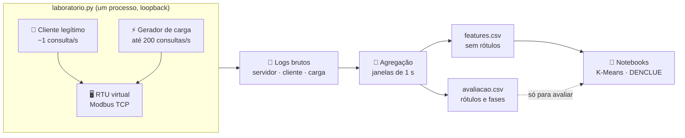

<div align="center">

# 🛡️ ClusterGuard SCADA

**Laboratório local de tráfego Modbus TCP para detecção de anomalias com K-Means e DENCLUE**


[Início rápido](#-início-rápido) •
[Como funciona](#-como-funciona) •
[Resultados](#-resultados-em-resumo) •
[Estrutura](#-estrutura-do-repositório) •
[Dados](#-dados-produzidos) •
[Limites](#-limites-da-conclusão)

</div>

---

## 📌 Sobre o projeto

O **ClusterGuard SCADA** simula, em uma única máquina, uma RTU Modbus TCP, uma estação supervisória legítima e um gerador de carga. Cada execução produz logs brutos e janelas de um segundo **sem rótulos**, com a verdade de referência guardada em arquivo separado. Os notebooks usam esses dados para testar se **K-Means** e uma versão didática de **DENCLUE** identificam janelas de carga anormal.

| | |
|---|---|
| 🧪 **Coleta** | Servidor Modbus TCP didático, cliente legítimo e carga controlada, tudo com a biblioteca padrão do Python |
| 📊 **Dados** | Logs brutos, características por janela de 1 s e rótulos temporais separados |
| 🤖 **Análise** | Notebooks com K-Means e DENCLUE, treino/validação/teste separados por ensaio |
| ✅ **Verificação** | 16 testes automatizados, reagregação reprodutível byte a byte |

> [!IMPORTANT]
> O escopo é **didático**: sensores sintéticos, tráfego em loopback e um único processo. O projeto não opera uma planta SCADA e não foi validado com equipamento físico. Veja [Limites da conclusão](#-limites-da-conclusão).

---

## 🚀 Início rápido

**Requisitos:** Python **3.11 ou superior**. A coleta usa apenas a biblioteca padrão.

```powershell
python --version
python laboratorio.py
```

Pronto. O programa sobe o próprio servidor em `127.0.0.1:5020`, o cliente legítimo e o módulo de carga, e grava tudo em uma pasta de resultados mostrada no terminal.

<details>
<summary><b>O que a execução padrão faz</b></summary>

<br>

A execução padrão dura cerca de **140 segundos**:

| Fase | Duração | O que acontece |
|---|---:|---|
| 🟢 Normal | 60 s | Só o cliente legítimo, cerca de 1 consulta/s |
| 🔴 Carga | 20 s | Consultas extras a no máximo 50/s |
| 🟡 Recuperação | 60 s | A carga para e a coleta continua |

- O programa **recusa sobrescrever** uma pasta de saída existente.
- Para escolher automaticamente uma porta local livre, use `python laboratorio.py --port 0`.
- Não rode os servidores de `originais/` ao mesmo tempo na porta 5020.

</details>

<details>
<summary><b>Para rodar os notebooks de análise</b></summary>

<br>

Os notebooks precisam de bibliotecas extras. O laboratório não precisa delas.

```powershell
python -m venv venv
venv\Scripts\activate
pip install numpy pandas matplotlib scikit-learn jupyter
jupyter notebook
```

Os arquivos de `originais/` usam `pymodbus` e têm instruções próprias em `originais/readme.txt`.

</details>

---

## 🧭 Como funciona



1. O servidor atende leituras de registradores (FC03) e registra cada resposta.
2. O cliente legítimo consulta os sensores e anota sucesso, timeout e latência.
3. Na fase de carga, o gerador soma consultas às do cliente. A taxa efetiva é **medida nos logs**, nunca presumida.
4. A agregação transforma os logs em janelas de 1 segundo e separa as características dos rótulos.
5. Os notebooks treinam sem ver os rótulos. Eles só servem para avaliar depois.

---

## 📈 Resultados em resumo

Teste no **cenário variável**: 12 ensaios, 2.160 janelas, com treino, validação e teste separados **por ensaio**. O teste tem 540 janelas, 183 delas de carga.

| Métrica | K-Means | DENCLUE didático |
|---|---:|---:|
| Acurácia | 0,7796 | 0,7722 |
| Precisão | 0,7254 | **1,0000** |
| Recall | **0,5628** | 0,3279 |
| F1 | **0,6338** | 0,4938 |
| Taxa de falsos positivos | 0,1092 | **0,0000** |

| Nível de carga | Janelas | K-Means detectou | DENCLUE detectou |
|---|---:|---:|---:|
| Baixa (2/s) | 60 | 3 (5,00%) | 0 (0,00%) |
| Média (5/s) | 60 | 42 (70,00%) | 0 (0,00%) |
| Alta (10/s) | 63 | 58 (92,06%) | 60 (95,24%) |

**Leitura:** o K-Means detecta mais carga, mas gera falsos alarmes. O DENCLUE didático não errou em nenhuma janela legítima, mas perdeu 123 das 183 janelas de carga, quase todas de carga baixa e média.

> [!NOTE]
> São apenas três ensaios de teste, e as janelas de um mesmo ensaio não são independentes. Não há intervalos de confiança. Detalhes e ressalvas em [`ALGORITMOS_IA.MD`](ALGORITMOS_IA.MD).

---

## 📁 Estrutura do repositório

```text
ClusterGuard-SCADA/
├── laboratorio.py            # Servidor, clientes, carga, cronograma e agregação
├── executar_experimentos.py  # Lote final: seeds 101–112
├── visualizar.py             # Acompanhamento no terminal
├── test_laboratorio.py       # 16 testes automatizados
├── notebooks/                # Preparação dos dados e análise (04–12)
├── datasets/                 # Consolidado experimental
├── resultados/               # Ensaios coletados
├── exemplos_validados/       # Três ensaios curtos de integração (Linux)
├── originais/                # Cliente e servidor iniciais, com pymodbus
├── METODOLOGIA.md            # Protocolo experimental e limites do método
├── ALGORITMOS_IA.MD          # K-Means, DENCLUE e métricas
└── VALIDACAO.md              # Resultados da verificação e limitações
```

| Documento | Leia quando quiser saber |
|---|---|
| [`METODOLOGIA.md`](METODOLOGIA.md) | Como o experimento foi desenhado e o que ele não mede |
| [`ALGORITMOS_IA.MD`](ALGORITMOS_IA.MD) | Como os modelos foram ajustados e avaliados |
| [`VALIDACAO.md`](VALIDACAO.md) | O que foi testado e o que não foi |

---

## 🔁 Repetir experimentos

Três repetições de uma **mesma** configuração (cerca de sete minutos):

```powershell
python laboratorio.py --normal 60 --carga 20 --recuperacao 60 --taxa 50 --seed 43 --saida resultados/repeticao_1
python laboratorio.py --normal 60 --carga 20 --recuperacao 60 --taxa 50 --seed 44 --saida resultados/repeticao_2
python laboratorio.py --normal 60 --carga 20 --recuperacao 60 --taxa 50 --seed 45 --saida resultados/repeticao_3
```

Depois, compare outras taxas mantendo os demais parâmetros.

> [!TIP]
> A seed controla as sequências pseudoaleatórias dos sensores e dos intervalos variáveis. Ela **não** reproduz o escalonamento, as latências nem os CSVs de uma nova execução.

**Lote final.** `python executar_experimentos.py` roda as seeds 101–112 com 60 s por fase, manutenção e carga em degraus. Ele ignora qualquer pasta já existente, mesmo incompleta, e também executa se for importado. Uma pasta ignorada não comprova conclusão.

**Interromper.** Ctrl+C deixa uma pasta parcial, que não deve entrar na análise. Uma pasta completa tem `ensaio.json` com `status: completo`, `features.csv` e `avaliacao.csv`.

> [!WARNING]
> **Limitação atual:** `run` grava o JSON só ao final da coleta, antes da agregação. Uma interrupção antes disso pode deixar a pasta sem JSON. Uma falha na agregação pode deixar `status: completo` sem os derivados completos. Esse status, sozinho, não certifica a conclusão: confira também o encerramento sem erro e os dois CSVs derivados. Não existe hoje um status explícito para ensaio incompleto.

### Perfis disponíveis

**Cliente variável.** `--perfil-cliente variavel` aplica variação uniforme de ±`--jitter` ao intervalo base. O padrão é `fixo`. Na manutenção, o intervalo base passa a `--intervalo-manutencao` e o jitter se aplica mesmo no perfil fixo. O período inclui o início e exclui o fim, avaliados após cada tentativa.

**Carga em degraus.** `--perfil-carga degraus` divide a duração total de carga em três partes iguais, com taxas baixa, média e alta.

Exemplo curto, em uma pasta nova:

```powershell
python laboratorio.py --port 0 --normal 1 --carga 1 --recuperacao 1 --perfil-cliente variavel --manutencao-inicio 0.2 --manutencao-duracao 0.4 --perfil-carga degraus --taxa-baixa 2 --taxa-media 5 --taxa 10 --seed 43 --saida resultados/verificacao_perfis
```

<details>
<summary><b>Tabela de parâmetros e limites da CLI</b></summary>

<br>

| Parâmetros | Restrição |
|---|---|
| `normal`, `recuperacao` | Positivos, finitos, até 600 s cada |
| `carga` | Positiva, finita, até 120 s no total, inclusive em degraus |
| `taxa` | Positiva, finita, até 200 consultas/s |
| `taxa-baixa`, `taxa-media` | Positivas e finitas; em degraus: baixa ≤ média ≤ taxa |
| `intervalo`, `intervalo-manutencao` | Finitos, no mínimo 0,1 s |
| `jitter` | Finito, entre 0 e 0,5 |
| `manutencao-inicio`, `manutencao-duracao` | Finitos, não negativos; início + duração ≤ fase normal |
| `port` | Inteiro entre 0 e 65535; 0 escolhe uma porta local livre |
| `seed` | Inteiro |

Os limites de duração se referem à configuração: uma tentativa iniciada antes do prazo pode terminar depois dele. O timeout de comunicação é de 0,5 s, e o fechamento da conexão ocorre fora desse bloco. O gerador é sequencial, sem fila ilimitada e sem compensação por rajadas quando atrasa. Não existe alvo remoto configurável.

</details>

---

## 📦 Dados produzidos

Cada ensaio gera uma pasta com estes arquivos:

| Arquivo | Conteúdo |
|---|---|
| `servidor.csv` | Uma linha por resposta concluída: horário e bytes Modbus recebidos/enviados, de todas as origens |
| `cliente.csv` | Tentativas legítimas: sucesso, timeout, latência, sensores e bytes |
| `carga.csv` | Tentativas do módulo de carga e seus resultados |
| `ataques.csv` | Início e fim efetivos da fase de carga e taxa alvo |
| `atividades_legitimas.csv` | Início e fim planejados da manutenção (só cabeçalho se desativada) |
| `ensaio.json` | Configuração, seed, porta efetiva, intervalo analisado e ambiente |
| `features.csv` | Características em janelas de 1 s, **sem rótulos** |
| `avaliacao.csv` | Rótulos temporais e fases, **separados** para avaliação |

Horários são Unix epoch em segundos. A última janela pode ser parcial. Os bytes estão na perspectiva do servidor e excluem cabeçalhos Ethernet/IP/TCP, handshakes e retransmissões: leituras usam 12 bytes de ADU Modbus e respostas de dois registradores usam 13.

<details>
<summary><b>Contrato de dados (colunas de cada arquivo)</b></summary>

<br>

Os CSVs são UTF-8, separados por vírgula, com cabeçalho e ponto decimal.

| Arquivo | Colunas, na ordem gravada |
|---|---|
| `servidor.csv` | `ts,bytes_rx,bytes_tx` |
| `cliente.csv`, `carga.csv` | `ts,origem,sucesso,timeout,latencia_ms,bytes_tx,bytes_rx,temp,pres,detalhe` |
| `ataques.csv` | `inicio,fim,tipo,taxa_alvo_rps` |
| `atividades_legitimas.csv` | `inicio,fim,tipo` |
| `features.csv` | `janela,ts_inicio,duracao_s,taxa_requisicoes,bytes_rx,bytes_tx,latencia_ms,taxa_timeout,taxa_erro,consultas_cliente,latencia_disponivel` |
| `avaliacao.csv` | `janela,label,fase` |

- `sucesso`, `timeout`, `label` e `latencia_disponivel` usam 0/1.
- Nos logs de tentativas, bytes são vistos pelo cliente. Em `servidor.csv` e `features.csv`, pelo servidor.
- `temp` e `pres` são valores sintéticos dos registradores, vazios quando não obtidos.
- `detalhe` registra a falha. Conexão não estabelecida conta como erro, mas `timeout` só recebe 1 depois de estabelecida a conexão.
- `ensaio.json` contém `inicio`, `fim`, `config`, `porta_efetiva`, `bytes`, `ambiente` e `status`. `config` guarda os argumentos com nomes convertidos para sublinhado, inclusive a seed. `fim` é o início mais a duração planejada das três fases, não uma medição. O JSON não registra a versão do Python nem a do sistema operacional.
- `taxa_requisicoes` conta as requisições atendidas no servidor por segundo, de **todas** as origens. O registro sai após o envio da resposta, então consultas incompletas não entram.
- As latências são fim a fim e incluem abertura e fechamento da conexão TCP, pois cada consulta abre uma conexão. Os clientes originais usavam conexão persistente: os números não são diretamente comparáveis.

</details>

---

## 🔬 Usando os dados na análise

As seis colunas exportadas como características, nesta ordem:

```python
colunas = [
    'taxa_requisicoes', 'bytes_rx', 'bytes_tx',
    'latencia_ms', 'taxa_timeout', 'taxa_erro'
]
```

- `taxa_timeout` e `taxa_erro` são frações entre 0 e 1 das tentativas legítimas. Erro inclui timeout.
- `latencia_ms` é a média das tentativas legítimas iniciadas na janela, incluindo as falhas.
- Janela sem consulta legítima fica com essas três medições **vazias**. Filtre ou impute com regra documentada, e **não** interprete como zero. `consultas_cliente` e `latencia_disponivel` ajudam nessa decisão.

**Nunca passe ao modelo:** `janela`, `ts_inicio`, `duracao_s`, colunas de controle, `avaliacao.csv`, fase, seed ou horários dos ataques. Depois de prever, una os resultados por `janela` para avaliar.

Os notebooks adotam uma seleção posterior de três colunas: `taxa_requisicoes`, `latencia_ms` e `latencia_disponivel`. Essa escolha é da análise e não altera o contrato de exportação (veja [`ALGORITMOS_IA.MD`](ALGORITMOS_IA.MD)). O consolidado `datasets/dataset_experimental.csv` contém rótulos e metadados e **não deve ser passado inteiro** ao modelo. Nos notebooks 09 e 10, os rótulos da validação só atribuem a classe aos clusters depois do ajuste.

O rótulo vale 1 quando a janela tem qualquer sobreposição com a carga, então janelas de fronteira podem ser mistas. Uma análise extra sem elas é útil. A fase de recuperação indica ausência de carga planejada, não certeza de normalidade.

---

## ✅ Testar e reagregar

```powershell
python -m unittest -v test_laboratorio.py
python laboratorio.py --agregar resultados/repeticao_1
```

A reagregação substitui somente `features.csv` e `avaliacao.csv` e não modifica os registros brutos. Os resultados da verificação estão em [`VALIDACAO.md`](VALIDACAO.md).

---

## 🚧 Limites da conclusão

- **Mede carga, não derrubada.** O experimento mede anomalias de tráfego sob carga de aplicação controlada. Não provoca falhas nem adiciona latência artificial. Aumento de taxa **não** prova indisponibilidade: só descreva como DoS efetivo se os registros mostrarem degradação. Se todos os clientes continuarem respondendo, relate aumento de carga, sem alegar negação de serviço.
- **Modbus parcial.** O servidor aceita só o subconjunto necessário (leitura FC03, 100 registradores). Não é uma RTU industrial completa.
- **Tudo no mesmo lugar.** Todos os papéis rodam no mesmo processo, event loop e computador. Isso limita a independência das medições e a generalização para redes industriais.
- **Testes locais.** Os testes validam este caminho autocontido. Não comprovam compatibilidade com todas as versões do pymodbus nem com equipamentos físicos.
